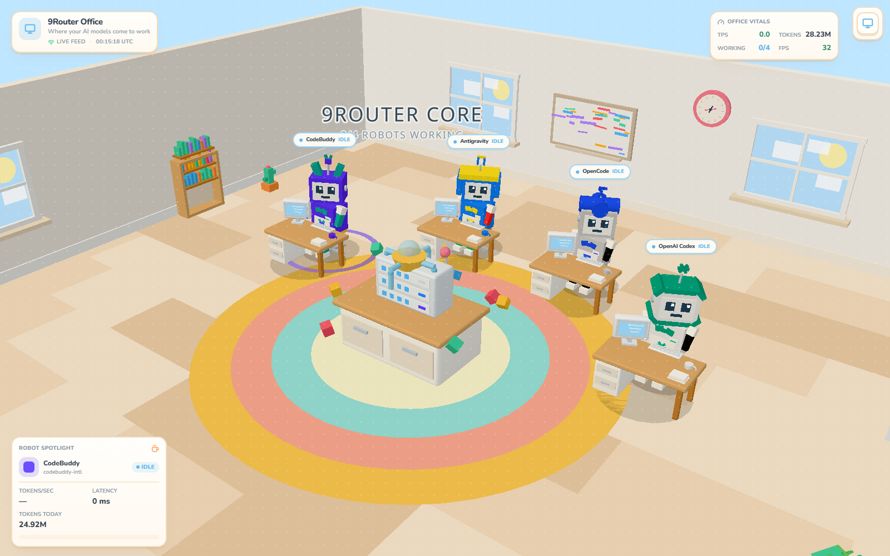
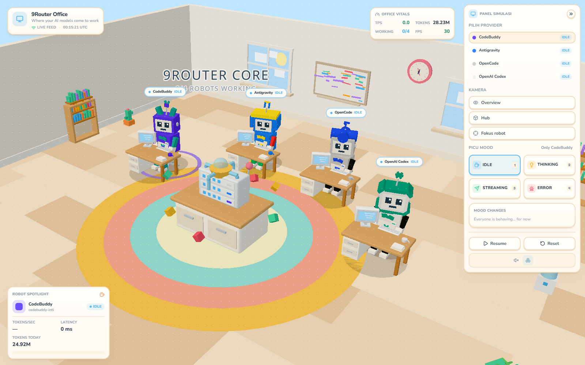

# 9Router 3D Spatial Agent HUD

A 3D observability dashboard for a local [9Router](https://9router.com) instance. Instead of charts,
every AI provider configured in 9Router becomes a blocky worker robot sitting at its own desk in a
bright, toy-like office diorama. The robots act out what the router is doing in real time — typing
frantically while streaming, thinking with a wobbling antenna, slumping when a provider runs dry —
and idle ones get up and wander around the office.

Everything runs locally. No cloud services, no paid APIs, no external 3D assets.


## What it does

- **Live telemetry from 9Router.** `/api/telemetry` reads the router's local SQLite database
  read-only and polls it into the client every 1.5 s. When 9Router is unreachable the HUD drops
  back to Simulation Mode automatically, so the office is never empty.
- **Per-provider robots.** Each provider gets a body shaped like its own logo — head crest, antenna
  topper, chest emblem — painted with a four-role brand palette taken from its logo: `body`,
  `limb`, `accent` and `extra`. Unknown providers fall back to the shared default body with a
  hash-derived colour.
- **Status as performance.** `IDLE`, `THINKING`, `STREAMING` and `ERROR` map to readable robot
  comedy: chair sways, fast typing, parcel launches, cartoon smoke. `ERROR` means *nothing left to
  serve* — every usable account for that provider is dead — and it raises a dismissible bubble with
  the failure text and its absolute reset date. Partial degradation stays silent on purpose.
- **Idle roaming.** Between tasks a robot stands up, walks to an office POI, inspects it, maybe
  dances, then sprints back when work arrives. Pure state machine, no pathfinding library.
- **Two bodies.** The procedural robot is the default; a generated `.glb` body is opt-in through
  `?model=on` or the HUD toggle. Both are driven by the same animation channels.
- **Built for integrated GPUs.** No real-time shadows, a demand-driven render loop throttled to
  ~30 FPS, and a full pause when the tab is hidden.

## Screenshots

| Collapsed panel | Generated `.glb` body |
| --- | --- |
|  |  |
| The right panel folds into a 56px rail and the camera gives the office the freed width back. | `?model=on` swaps every bot to the generated `.glb` body. |

## Quick start

```bash
npm install
npm run dev
```

Open <http://localhost:3001>. The dev script pins port 3001 because 9Router's telemetry API expects
the dashboard on that origin.

The office works immediately in Simulation Mode. To show real data, run 9Router locally and point
the app at its database — it is found automatically in the first location that exists:

| Platform | Default path |
| --- | --- |
| Windows | `%APPDATA%/9router/db/data.sqlite` |
| macOS | `~/Library/Application Support/9router/db/data.sqlite` |
| Linux | `~/.config/9router/db/data.sqlite` |

Set `NINEROUTER_DB_PATH` to override. The database is opened read-only, so the HUD never writes to
your router's state.

### URL parameters

| Parameter | Effect |
| --- | --- |
| `?capture=1` | Keeps the WebGL drawing buffer and suppresses idle roaming, so screenshots and layout gates measure a deterministic scene. |
| `?model=on` | Forces the generated `.glb` robot body. `?model=off` forces the procedural one. |

### Keyboard

`1`–`4` trigger the four manual moods for the selected robot. The dock also has broadcast-to-all,
cycle, and reset.

## Checks

Everything below runs from the repo root. The unit gates need nothing but Node; the browser gates
need a running app and Chrome with remote debugging enabled.

```bash
npm run typecheck      # tsc --noEmit
npm run lint           # eslint, zero warnings tolerated
npm run identity:test  # provider identity truth table (no browser)
npm run status:test    # provider status truth table (no browser)
npm run transport:test # pause/source rules (no browser)
npm run store:test     # the real store: brake, status decay, provenance (no browser)
npm run roam:test      # idle-roam state machine (no browser)
npm run layout:unit    # HUD geometry, including the collapsed rail (no browser)
npm run build:model    # regenerate public/models/worker-robot.glb from robotModel.ts
```

Browser gates — start the app, then launch Chrome headless with `--remote-debugging-port`:

```bash
npm run smoke                 # page-ready + zero console errors        (CDP 9223)
npm run identity:render       # per-part colour gate, procedural rig    (CDP 9223)
npm run identity:render:model # per-part colour gate, .glb rig          (CDP 9223)
npm run perf                  # frame-budget probe                       (CDP 9223)
npm run layout:test           # 15-viewport HUD layout gate             (CDP 9224)
```

The browser gates read `TARGET_URL`, so they can point at any port:

```bash
TARGET_URL='http://localhost:3001/?capture=1' npm run identity:render
```

`identity:render` is the gate worth understanding: it walks the live three.js scene graph and checks
that every named part wears the exact colour its role resolves to, for every provider on stage. It
is what catches a component that re-implements spec geometry and quietly drops the colour contract —
a class of bug that unit tests on the tables cannot see.

## Architecture

The HUD is a Next.js 16 app: a single R3F canvas, a Zustand telemetry store as the source of truth, a
separate presentation store for UI state, and a polling bridge that feeds live router data in without
ever overwriting a manual demo.

- `src/lib/routerAdapter.ts` — reads 9Router's SQLite, resolves provider status and errors.
- `src/lib/statusResolution.ts` — the pure status rules, shared by the server and the test gate.
- `src/lib/providerIdentity.ts` — per-provider shells, toppers, emblems and four-role palettes.
- `src/lib/robotModel.ts` — the single source of robot geometry, consumed by both the runtime and
  the `.glb` generator.
- `src/lib/idleRoamState.ts` — the pure roaming state machine.
- `src/store/useAgentStore.ts` / `useUiStore.ts` — telemetry vs presentation, kept strictly apart.

See [`ARCHITECTURE.md`](ARCHITECTURE.md) for the full data flow, the identity tables, and what each
gate proves. [`AGENTS.md`](AGENTS.md) carries the project constraints and phase history;
[`TASKS.md`](TASKS.md) is the phase-by-phase log.

## Generated assets

`public/models/worker-robot.glb` is generated, not hand-modelled. `npm run build:model` rebuilds it
from `src/lib/robotModel.ts` — the same numbers the procedural body uses — so the two bodies can
never drift apart. The output is deterministic: rebuilding without changing the model yields a
byte-identical file.

## License

MIT © 2026 Bagas Hari Muthi. See [`LICENSE`](LICENSE).

Third-party dependencies keep their own licenses — notably Next.js (MIT), React (MIT),
three.js (MIT) and zustand (MIT). The office diorama, the robot geometry and the generated
`worker-robot.glb` are original work released under the same MIT terms.
